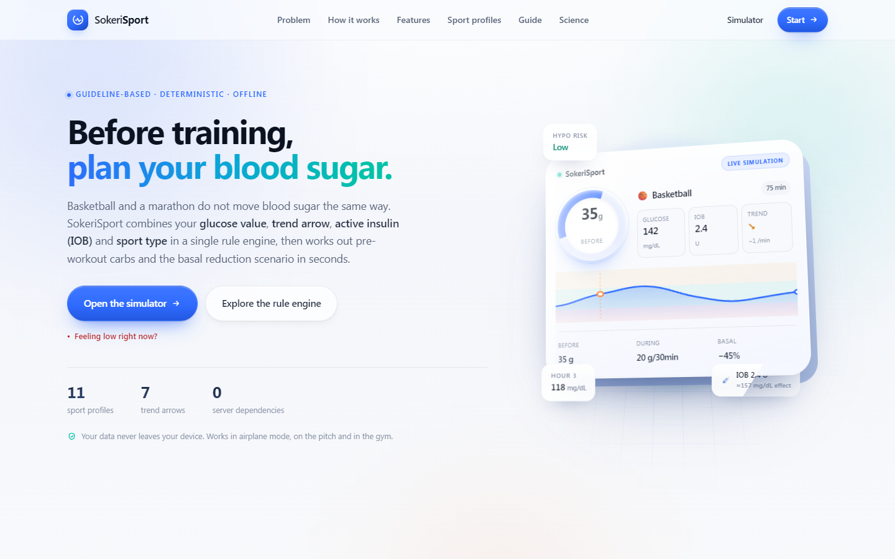
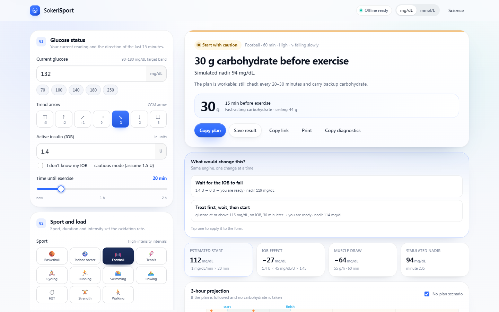
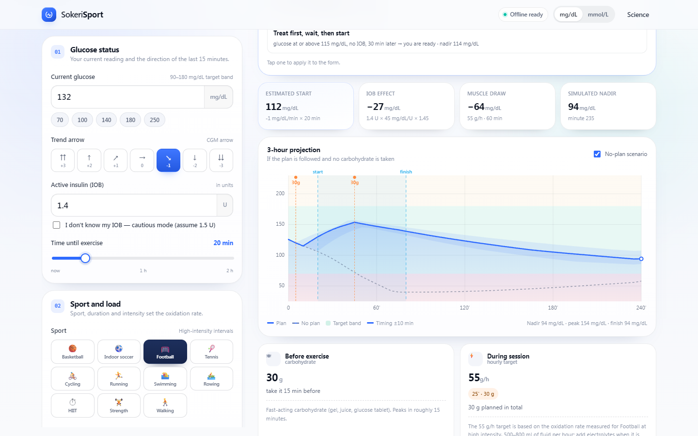
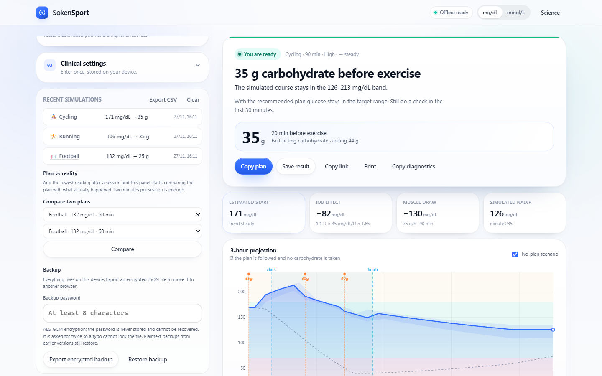
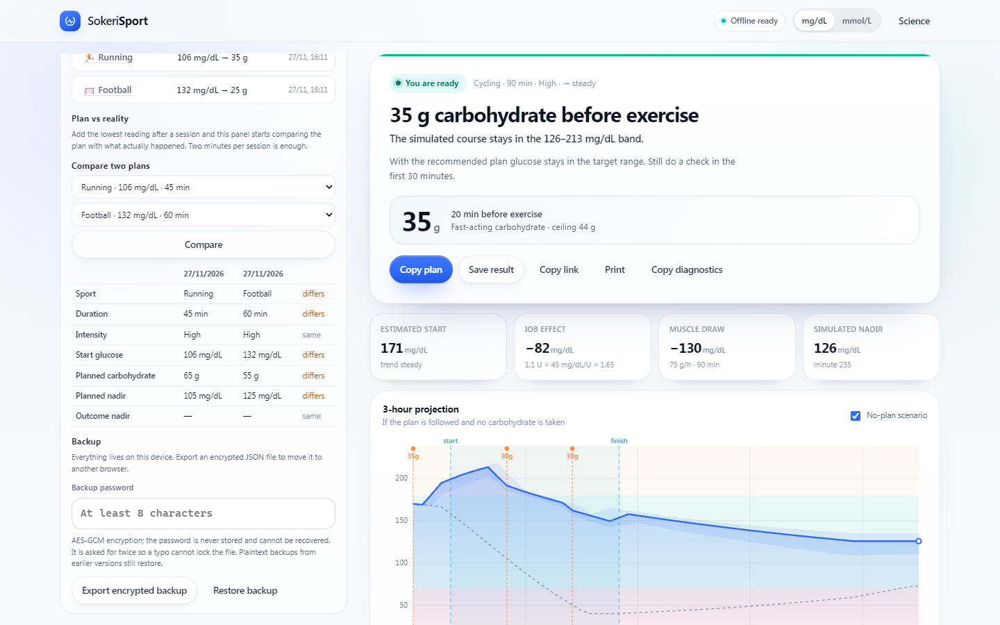
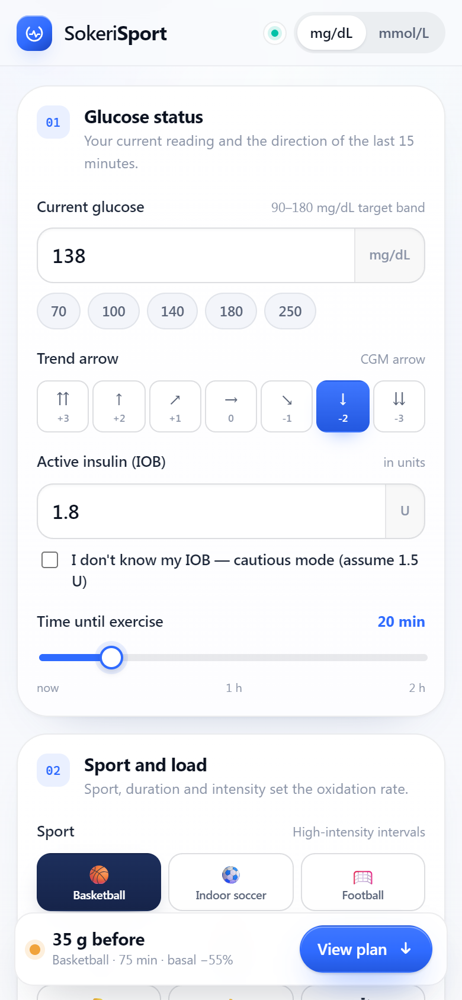
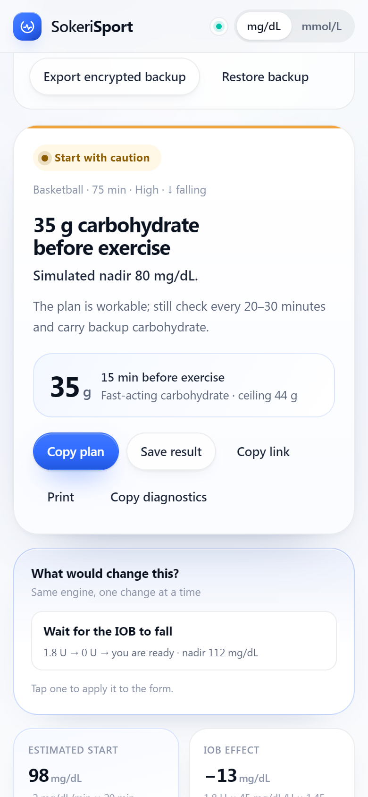
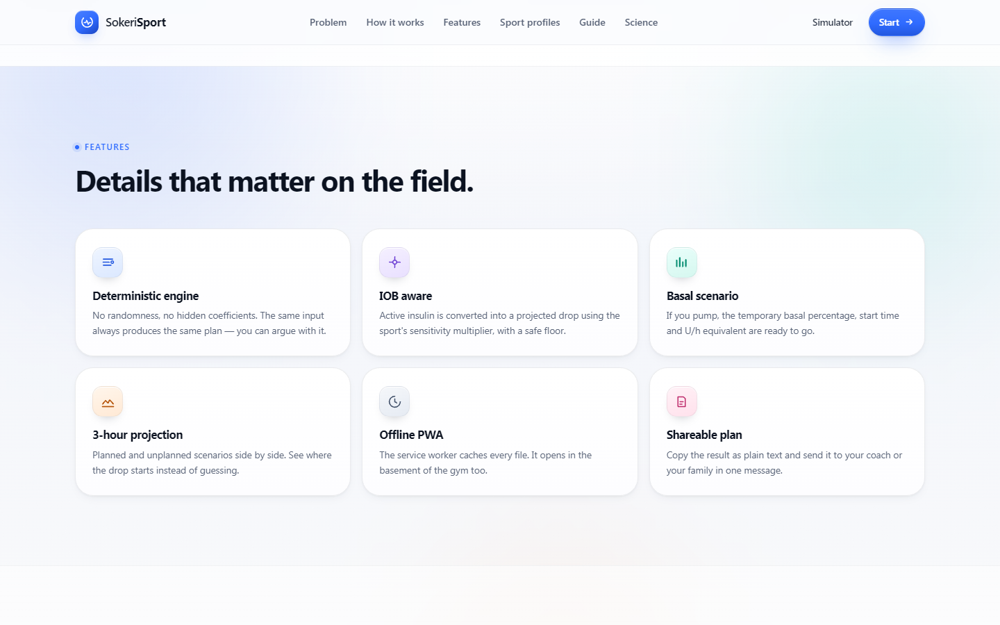
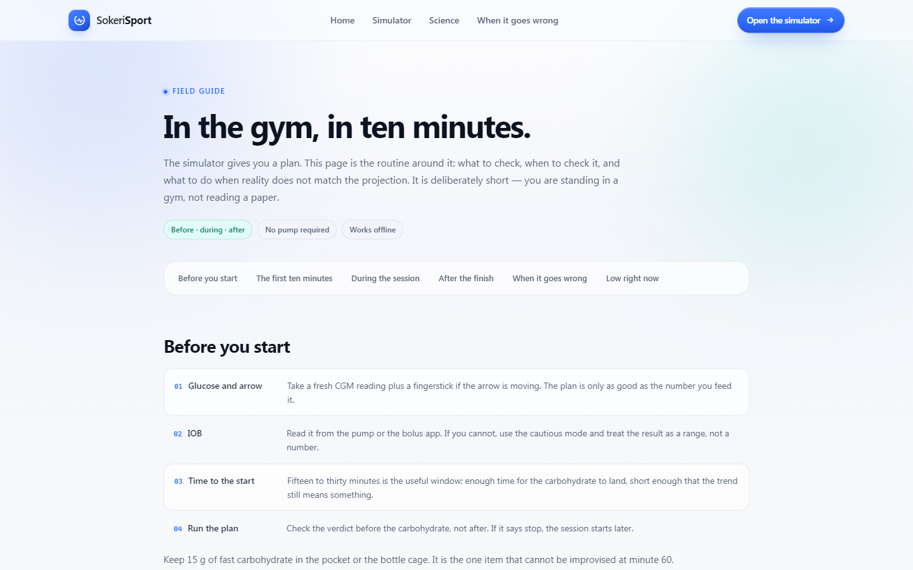
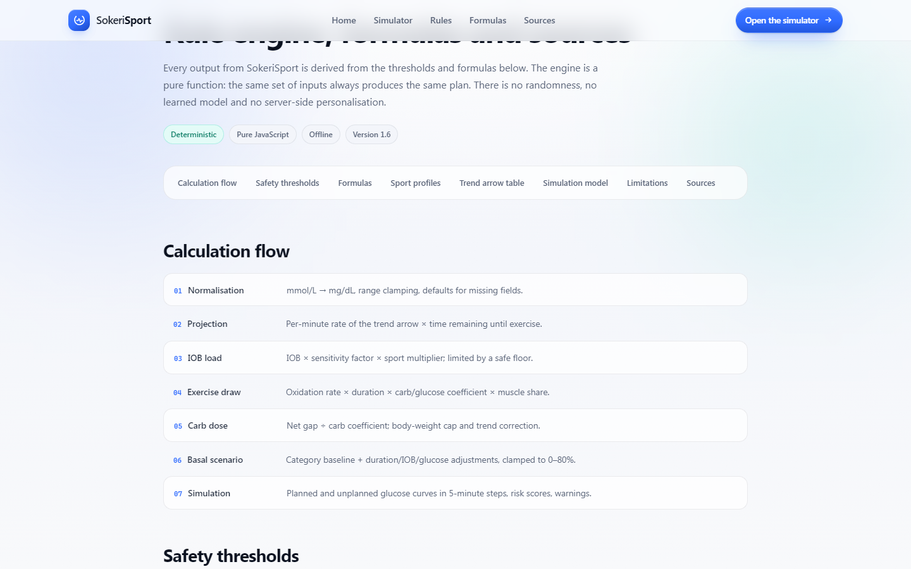

# SokeriSport

**Plan the blood sugar side of a training session before you put your shoes on.**

[](https://github.com/ErdalBirinci/SokeriSport/actions/workflows/ci.yml)
[](https://erdalbirinci.github.io/SokeriSport/)
[](LICENSE)
[](manifest.webmanifest)
[](package.json)

[](https://erdalbirinci.github.io/SokeriSport/)

SokeriSport is a **glycemic readiness simulator** for exercise with type 1 diabetes. It takes the
five things you already know before a session — current glucose, the CGM trend arrow, active insulin
(IOB), the sport and how hard you plan to go — and runs them through one **deterministic rule
engine**. The result is a concrete, explainable plan: how much carbohydrate to take and when, what
to eat during the session, how much to reduce a pump basal, and what the next three hours are likely
to look like.

It is a single-page app built with **vanilla JavaScript**, shipped as a **PWA**, with **no framework,
no build step, no dependencies and no server**. Every calculation happens on your device, the numbers
you type never leave the browser, and the same input always produces the exact same plan — so you can
disagree with it, inspect it and reproduce it.

> **Medical notice:** SokeriSport is an education and simulation tool. It does not diagnose, does not
> adjust treatment and is not on its own a basis for an insulin or carbohydrate dose. Decisions should
> be made together with your diabetes team.

---

## Contents

- [Screenshots](#screenshots)
- [What it does](#what-it-does)
- [How the engine works](#how-the-engine-works)
- [The plan, end to end](#the-plan-end-to-end)
- [Your data stays on your device](#your-data-stays-on-your-device)
- [Running it](#running-it)
- [Project structure](#project-structure)
- [Testing and quality gates](#testing-and-quality-gates)
- [PWA and offline behaviour](#pwa-and-offline-behaviour)
- [Sport profiles](#sport-profiles)
- [Publishing](#publishing)
- [Evidence, limits and sources](#evidence-limits-and-sources)
- [Feedback](#feedback)

---

## Screenshots

Every image below is a real capture of the app in English, taken at 1440×900 on desktop and
390×844 on a phone.

### The simulator

| Input side | The plan it produces |
|:--:|:--:|
| [](docs/screenshots/simulator.png) | [](docs/screenshots/plan.png) |
| Glucose, trend, IOB and timing on the left, the live verdict on the right. | The verdict, the four calculation rows and the 3-hour projection with the uncertainty band. |

### History, comparison and backup

| Saved simulations | Two plans side by side |
|:--:|:--:|
| [](docs/screenshots/history.png) | [](docs/screenshots/compare.png) |
| Every simulation is stored locally, with CSV export and an encrypted backup. | Pick any two saved plans and compare duration, glucose, carbs and projected nadir. |

### On a phone

| Input | Plan |
|:--:|:--:|
| [](docs/screenshots/simulator-mobile.png) | [](docs/screenshots/plan-mobile.png) |
| One-handed layout, unit toggle and a sticky summary bar. | The verdict first, then the numbers and the actions. |

### Documentation and the landing page

| Landing page | Feature overview |
|:--:|:--:|
| [](docs/screenshots/landing-hero.png) | [](docs/screenshots/landing-features.png) |
| The public entry point, with a live mini-simulation. | What the engine covers, in plain language. |

| Field guide | Rule engine and formulas |
|:--:|:--:|
| [](docs/screenshots/guide.png) | [](docs/screenshots/science.png) |
| The routine around the plan: before, during, after, and when it goes wrong. | The published thresholds, every formula and the references behind them. |

---

## What it does

- **Pre-workout carbohydrate** in grams, with a timing window and a fast/slow carbohydrate choice.
- **In-session fuelling** as an hourly target and a schedule of 15–60 g steps for the duration you
  entered.
- **Pump basal scenario** — the temporary basal percentage, when it should start and what it means
  in U/h.
- **A 3-hour glucose projection** in 5-minute steps, with the planned curve next to the no-plan
  curve and a ±10 min / ±0.3 U uncertainty band.
- **A verdict you can argue with** — `safe`, `caution`, `postpone` or `no exercise`, each with the
  reason. Hypoglycemia, ketones and very high glucose short-circuit the normal calculation.
- **"What would change this?"** — when the verdict is not safe, the same engine re-runs realistic
  single changes (wait for IOB, start later, shorten, one step easier, fast carbs, treat first) and
  offers only the ones that actually improve the verdict.
- **Plan vs outcome** — record the real start glucose, the lowest reading, the carbohydrate actually
  taken and whether a hypo happened; the app then compares plan and reality locally.
- **Compare two plans** and **export CSV** for a care-team conversation.
- **Share links and diagnostics** — a link reproduces the current scenario, and the diagnostics
  payload contains version, inputs and plan.
- **Encrypted backup** — profile and history export as one AES-GCM file, protected by a password you
  choose.
- **Works offline** — installable, cached app shell, no network calls at runtime.
- **Units at the edge** — mg/dL or mmol/L, converted only at the form boundary; the engine always
  works in mg/dL.

---

## How the engine works

`buildPlan(input)` is a pure function: same input → same output. There is no randomness, no learned
model and no server-side personalisation.

### Input

| Field | Meaning | Default |
| --- | --- | --- |
| `glucose` | Current glucose (mg/dL or mmol/L) | 140 |
| `trend` | CGM trend arrow (`doubleUp … doubleDown`) | `flat` |
| `iob` | Active insulin (U) | 0 |
| `diaHours` | Insulin duration of action | 4 |
| `isf` | Sensitivity factor (mg/dL/U) | 45 |
| `weightKg` | Body weight | 74 |
| `sport` | Sport (basketball, football, running, cycling …) | basketball |
| `durationMin` | Duration | 75 |
| `intensity` | 1–4 (light → maximal) | 3 |
| `leadTimeMin` | Time until exercise | 20 |
| `ketones` | `none / trace / moderate / high` | `none` |
| `carbType` | Pre-workout carbohydrate source: `fast` (gel, juice, tablet) or `slow` (oats, bread, banana) | `fast` |
| `heat` | Training in the heat: faster insulin absorption, small extra oxidation | `false` |
| `pump` / `basalRate` | For the basal scenario | `true` / 0.9 |

### Output

`status`, `preCarb`, `during`, `basal`, `after`, `timing`, `risks`, `warnings`, `rationale`,
`checks` and `simulation` (planned and unplanned glucose curves).

### Core formulas

```
G_start = G_now + (r_trend × t_left)
D_IOB   = min( IOB × ISF × k_sport , max(0, G_start − 85) )
D_muscle= O_hour × t_hour × K_cho × 0.35
g_CHO   = ( target − G_start + D_IOB + D_muscle − catecholamine ) / K_cho
K_cho   ≈ 3.5 mg/dL/g @70 kg  (scales inversely with weight)
```

The carbohydrate dose is rounded to 5 g and capped by `min(50 g, 0.6 × kg)`.

### Safety thresholds (applied in order)

| Condition | Decision |
| --- | --- |
| Glucose < 70 mg/dL | No exercise — treat hypoglycemia first |
| Ketones ≥ moderate and glucose ≥ 250 mg/dL | No exercise |
| Glucose ≥ 300 mg/dL | Postpone, check ketones |
| Estimated start < 90 mg/dL | Take carbs, wait 15 min |
| Simulated nadir < 70 mg/dL | Plan or postpone |
| Simulated nadir < 85 mg/dL or IOB > 2 U | Start with caution |
| Otherwise | Safe |

### Simulation

5-minute steps, four components: insulin action (spread across the DIA, amplified by the exercise
sensitivity multiplier), trend drift (decays with a 30-min time constant), muscle draw (sport
oxidation) and carbohydrate absorption (delay + absorption window). Below 90 mg/dL a partial
counter-regulation is added; the result is clamped to 40–350 mg/dL.

---

## The plan, end to end

1. **Enter the five inputs.** Glucose, trend arrow, IOB, sport and how long until you start. The plan
   updates as you type; nothing is submitted anywhere.
2. **Read the verdict.** Colour, headline and the reason, plus the exact projected start glucose,
   IOB effect, muscle draw and simulated nadir.
3. **Act on it.** Take the grams it suggests, follow the in-session schedule, set the temporary basal
   if you pump, or apply one of the "what would change this?" alternatives.
4. **Record what actually happened.** Save the simulation, then log the real start, the lowest
   reading, the carbs taken and whether a hypo occurred.
5. **Review.** The history shows plan vs reality, the statistics box summarises sessions, the mean
   nadir difference, hypos and carbohydrate adherence, and CSV export is one tap away.

### Plan, outcome and export

- **Log outcome** — the history keeps the values the engine actually used, not a transient typed
  value.
- **CSV export** — one row per simulation, plan values and recorded outcome side by side, with
  spreadsheet-formula escaping so a field can never turn into a formula.
- **Print / PDF** — `Print` hides the form and prints the plan, the calculation rows and the chart.
- **Uncertainty band** — the chart shades the effect of ±10 min of timing error and ±0.3 U of IOB
  error; the engine is deterministic, so each variant is just another deterministic run.
- **Validated restore** — a profile, share link or imported backup is sanitised field by field:
  unknown sports, malformed units and out-of-range numbers fall back to safe values instead of
  breaking the form.

---

## Your data stays on your device

- **No account, no server, no analytics.** The app makes no network request after the assets load.
- **localStorage only.** The profile and the last 50 simulations live in the browser. Clearing site
  data removes them.
- **Encrypted backup.** `Export encrypted backup` writes one JSON envelope:

```json
{
  "format": "sokerisport-backup",
  "formatVersion": 1,
  "kdf": { "name": "PBKDF2", "hash": "SHA-256", "iterations": 250000, "salt": "…" },
  "cipher": { "name": "AES-GCM", "iv": "…" },
  "data": "…"
}
```

The key is derived from the password in the browser with WebCrypto. The password is never stored,
never written to the file and never sent anywhere. The form asks for it twice and refuses a mismatch
before deriving a key, so a one-character typo cannot lock the file. A wrong password and a modified
file both fail the AES-GCM authentication check and restore nothing. Plaintext backups exported by
earlier builds still import and are migrated on read.

- **Share links contain health values.** A share link encodes the current scenario so it can be
  reproduced; sharing is a deliberate action. The same applies to the diagnostics payload.
- **Destructive actions ask first.** Clearing the history or restoring a backup requests
  confirmation before anything is replaced.

---

## Running it

**Live:** <https://erdalbirinci.github.io/SokeriSport/>

```bash
node server.mjs          # http://127.0.0.1:5173
# or
npm run dev
```

The service worker only runs over `http://` or `https://`, so use the server instead of opening the
file directly (`file://`).

```bash
npm test                 # rule engine, scenarios, CSV, backup, version and language guards
npm run check            # internal links/anchors + service worker VERSION guard
npm run build            # copies the public files into dist/
npm run golden           # regenerates the golden plan fixtures (review the diff)
npm run icons            # regenerates the PNG icons
```

Requirement: Node 20+ (development and tests only; the app itself runs in the browser).

---

## Project structure

```
index.html                 Landing page (light 3D design, live mini-simulation)
app.html                   Simulator
science.html               Rule engine, formulas, thresholds, sources
guide.html                 Field guide: before / during / after a session
manifest.webmanifest       PWA manifest + shortcuts
sw.js                      Cache + offline strategy
server.mjs                 Dependency-free static server (for service worker testing)

assets/css/base.css        Tokens, reset, shared components
assets/css/landing.css     Landing + documentation layout, 3D scene
assets/css/app.css         Simulator interface

assets/js/engine.js        Deterministic rule engine + simulation (pure, side-effect free)
assets/js/scenario.js      State sanitising + share-link encode/decode (pure)
assets/js/csv.js           CSV export with formula-safe escaping (pure)
assets/js/backup.js        Password-encrypted backup: PBKDF2 + AES-GCM (WebCrypto)
assets/js/stats.js         Plan-vs-outcome statistics (pure)
assets/js/version.js       Version shown in diagnostics (guarded against package.json)
assets/js/chart.js         Dependency-free canvas timeline
assets/js/storage.js       localStorage profile + history (50 entries)
assets/js/app.js           Simulator interface
assets/js/landing.js       Sport cards, 3D parallax, scroll reveal
assets/js/docs.js          Science page tables
assets/js/pwa.js           Service worker registration, install prompt, offline pill
assets/js/hypo.js          Low-glucose card (static, engine-free)

docs/screenshots/          The images used in this README
icons/*.png                PWA icons (generated by script)
assets/img/favicon.svg     Vector favicon
assets/img/og.jpg          Social preview image

scripts/make-icons.mjs     Dependency-free PNG generator
scripts/check-links.mjs    Internal link + anchor checker (CI)
scripts/check-sw-version.mjs  Requires a sw.js VERSION bump when assets change (CI)
scripts/update-golden.mjs  Regenerates the golden plan fixtures
scripts/build.mjs          Copies only public files into dist/

tests/engine.test.mjs      Engine behaviour and thresholds
tests/golden.test.mjs      Golden plans + a performance bound
tests/scenario.test.mjs    State sanitising and share-link round-trips
tests/csv.test.mjs         CSV columns and spreadsheet-formula escaping
tests/backup.test.mjs      Encrypted backup round-trips and legacy plaintext imports
tests/version.test.mjs     Version and offline-shell guards
tests/language.test.mjs    English-only and legacy-unit guard
tests/fixtures/            Golden scenarios, snapshot shape and expected output

.github/workflows/ci.yml   Tests, link check and cache-busting guard
REVIEW.md                  Clinical review record and threshold change policy
LICENSE                    MIT
```

---

## Testing and quality gates

The suite runs on Node's built-in test runner, without dependencies: **81 tests** covering the rule
engine, golden fixtures, scenario sanitising, CSV escaping, encrypted backups, version consistency and
the English-only language guard.

| Gate | Command | What it protects |
| --- | --- | --- |
| Tests | `npm test` | Engine, golden plans, backup crypto, sanitising, CSV, version |
| Links | `npm run check` | Every internal link and anchor resolves |
| Cache busting | `npm run check` | `sw.js` VERSION must change when shipped assets change |
| Language | `npm test` | No Turkish UI strings or legacy unit shorthands leak in |
| Live site | `npm run live` | The published bytes still match this checkout |

The golden fixtures pin the engine output for a set of representative scenarios, so a threshold change
shows up as a reviewable diff instead of a silent behaviour change. `REVIEW.md` records the clinical
review behind the thresholds and the policy for changing them.

Accessibility is part of the interface, not a later pass: skip link, focus management after a plan is
rendered, `aria-pressed` unit and option buttons, labelled controls, a live region that announces
plan changes without flooding a screen reader, visible focus rings and reduced-motion support.

`npm run live` compares the published site with this checkout: every file the service worker
precaches, every manifest icon, every README screenshot and the branded 404 page must answer with the
exact local bytes, and the served `version.js`/`sw.js` must carry the `package.json` version. The
`Live site` workflow runs it every day at 05:23 UTC and on demand. A failed run opens a GitHub issue
labelled `live-site`, assigned to the repository owner, so the break arrives as a notification; a
repeat failure comments on that issue and the next green run closes it. To prove the alert on
demand, dispatch the workflow with a broken `base_url`.

---

## PWA and offline behaviour

- **Installable** — standalone display, theme colour, maskable icon and app shortcuts for the
  simulator and the field guide.
- **Offline shell** — the service worker precaches every shipped file; navigations are network-first
  with a cached fallback, static assets are cache-first with a silent background update.
- **No hidden network** — the app works in airplane mode, in a basement gym or on the pitch.
- **Safe updates** — cache names carry the app version, and CI refuses a shipped-asset change that
  does not bump `sw.js` VERSION.

---

## Sport profiles

| Sport | Category | Oxidation (g/h) | Sensitivity × |
| --- | --- | --- | --- |
| Basketball | IHE | 42 | 1.45 |
| Indoor soccer | IHE | 46 | 1.50 |
| Football | IHE | 44 | 1.45 |
| Tennis | IHE | 32 | 1.30 |
| Cycling | Endurance | 60 | 1.65 |
| Running | Endurance | 58 | 1.70 |
| Swimming | Endurance | 50 | 1.55 |
| Rowing | Endurance | 55 | 1.60 |
| HIIT | Mixed | 28 | 1.25 |
| Strength | Strength | 22 | 1.15 |
| Walking | Low | 18 | 1.25 |

Each profile also carries an adrenergic credit for the transient rise in the first minutes of
high-intensity work, and a note explaining where the drop risk comes from.

---

## Publishing

The app is plain static files, so any static host can serve the repository root; GitHub Pages does.

```bash
node scripts/build.mjs   # copies only public files into dist/
```

`scripts/build.mjs` writes a self-contained `dist/` folder for hosts that want a separate upload
directory. When releasing a new version:

1. Make the change and run `node scripts/build.mjs`.
2. Bump `VERSION` in `sw.js` — otherwise clients keep seeing the cached old assets (static assets
   are cache-first).

---

## Evidence, limits and sources

SokeriSport encodes published guidance as rules; it does not fit a model to your data and it does not
predict an individual's response. The uncertainty band shows how sensitive a plan is to timing and IOB
error, and the "what would change this?" list shows which single change would move the verdict. The
limits are stated on the science page: no pump history, no fat/protein delay, no illness or alcohol
model, no automatic CGM connection.

1. Riddell MC et al. *Exercise management in type 1 diabetes: a consensus statement.* Lancet Diabetes Endocrinol. 2017.
2. Moser O et al. *Glucose management for exercise using CGM: EASD/ISPAD position statement.* Diabetologia. 2020.
3. Colberg SR et al. *Physical Activity/Exercise and Diabetes: ADA position statement.* Diabetes Care. 2016.
4. ADA Standards of Care — Glycemic Goals and Hypoglycemia.
5. Battelino T et al. *Clinical Targets for CGM Data Interpretation (Time in Range).* Diabetes Care. 2019.
6. Yardley JE et al. *Resistance versus aerobic exercise: acute effects on glycemia in type 1 diabetes.* Diabetes Care. 2013.
7. Scott SN et al. *Carbohydrate Intake in the Context of Exercise in People with Type 1 Diabetes.* Nutrients. 2019.
8. Walsh J, Roberts R. *Pumping Insulin* (insulin action curves, IOB).

Full threshold table, model limitations and complete references: `science.html`.

---

## Feedback

Bugs and questionable plans: [open an issue](https://github.com/ErdalBirinci/SokeriSport/issues/new/choose)
— the form asks for the simulator inputs and the output you saw. There is no analytics or tracking
script: the app still keeps every value on the device.

## Disclaimer

SokeriSport is an **education and simulation** tool. It does not diagnose, does not adjust treatment
and is not on its own a basis for an insulin or carbohydrate dose. Decisions should be made together
with your diabetes team. If you feel hypoglycemia symptoms, stop exercising and take fast
carbohydrate.

## License

MIT — see [LICENSE](LICENSE).
